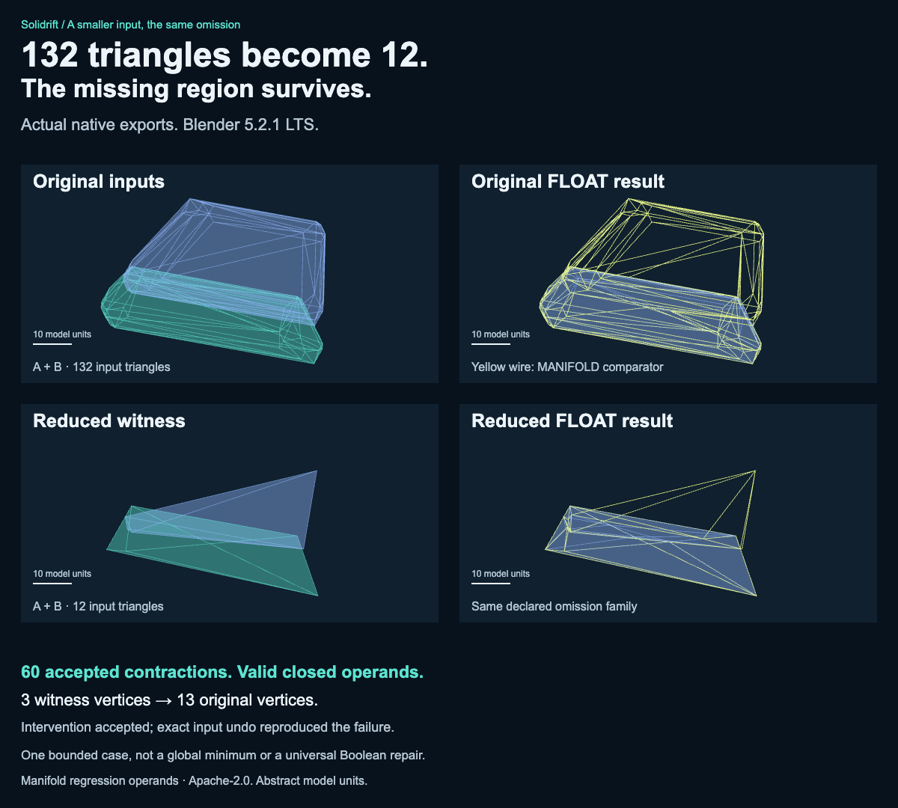

# Solidrift

**Shrink a geometry failure without losing the bug.**

A Boolean union should combine both input solids. On this Manifold regression case, Blender's `FLOAT` solver drops the second region. Solidrift reduces the inputs while retaining that omission, then lifts a small, reversible geometry intervention back to the full model.

[Try the native case](#try-the-case) · [Open the fresh investigation and reader guide](docs/presentation/README.md) · [Download the native example](docs/presentation/solidrift-native-reader.zip)

<picture>
  <source media="(max-width: 600px)" srcset="docs/presentation/witness-mobile.png">
  
</picture>

## A failure a maintainer can carry

A fresh **Blender 5.2.1 LTS** run, build **`9e2066aef7ef`**, made 395 native Boolean queries. It accepted 60 contractions, taking **132 triangles to 12**, with both operands remaining valid closed solids under Solidrift's conservative stored-number guard. This is one bounded greedy result, not a globally smallest witness.

The accepted intervention moves three witness vertices whose ancestry covers thirteen original vertices in operand A. Operand B and every face index stay unchanged. The repaired `FLOAT` and `MANIFOLD` outputs have matching oriented triangles, with paired surface separation bounded by **4.272e−6 model units**. Undo restores the original input coordinates exactly and reproduces the omission. This changes the input geometry; it does not fix Blender's implementation or prove the ideal union.

The [native `.blend`](docs/presentation/native/inspection.blend), [editable native script](docs/presentation/native-scene.py), [full report](docs/presentation/case/report.json), [OBJ exports](docs/presentation/case/meshes/witness-A.obj) and [offline viewer](docs/presentation/case/report.html) travel with the example. A second Blender process reopened the scene and OBJ pair, checked all eight displayed mesh data blocks, and repeated the four decisive `FLOAT` queries: original failure, witness failure, accepted repair and restored failure. Read the [guide](docs/presentation/README.md) for exact version, units, display offsets and verification boundaries.

The two input meshes are Manifold's Apache-2.0 regression data, not our original models. Solidrift supplies the reducer, ancestry lift, bounded intervention search, conservative geometry checks and portable inspection workflow. Blender supplies the Boolean implementations; MANIFOLD is a comparator, not ground truth.

The original [19-second geometry tour](https://nazeeh111.github.io/Solidrift/tour.html), [poster](docs/media/solidrift-tour.jpg) and [editable tour source](tools/tour/README.md) remain available. That recorded Original → Reduction → Witness → Repair → Undo investigation samples stored input states and shows only stored native output surfaces. The browser viewer never runs Blender.

## Try the case

Python 3.10 or later. Blender with the `FLOAT` and `MANIFOLD` Boolean solvers. No Python dependencies, cloud service, account or model API.

The bundled demo is verified on Blender `5.3.0 Alpha` (`bad8871dc58d`). A fresh Blender `5.1.2` (`ec6e62d40fa9`) run refuses it because the MANIFOLD comparison output fails the solid checks. Having both solver names does not establish compatibility. See the [backend results](docs/EVIDENCE.md#backend-compatibility). The recorded browser case needs no Blender.

```sh
git clone https://github.com/nazeeh111/Solidrift.git
cd Solidrift
python -m solidrift demo --blender /path/to/blender --out case
```

This runs the native engine from the original operands. The public viewer shows recorded outputs; it does not execute Blender in your browser.

## Investigate your own operands

```sh
python -m solidrift analyze A.obj B.obj --blender /path/to/blender --out my-case
```

Use a new output directory. Your original files are preserved. Accepted input is two triangular OBJ meshes, each one connected, closed and outward-oriented, with at most 256 triangles per operand. Coordinates are imported as Blender's binary32 values; the report records that conversion.

The current detector is deliberately specific: a `FLOAT` union that returns approximately operand A's signed volume while omitting the larger operand B. It does not detect every kind of Boolean error. Healthy inputs or unsupported failures produce an explicit result rather than a fabricated witness.

## What travels with the bug

- Original bytes and input identities.
- Original, reduced, repaired and restored mesh operands, plus native outputs.
- The accepted contraction trace, source clusters and before/after coordinate patch.
- Validity checks, comparison results, budgets and backend identity.
- An offline HTML viewer and machine-readable JSON report.

The viewer has linked orbit controls, intermediate input-state replay and clickable witness vertices for ancestry. Intermediate native output surfaces are not stored; the viewer says so instead of interpolating invented results.

## A real case, with conventional controls

On the included Manifold regression operands, Blender `5.3.0 Alpha`, build `bad8871dc58d`:

| Observation | Result |
|---|---|
| Original operands | 70 vertices / 132 triangles; both pass the single-shell guard |
| Failure-preserving reduction | 10 vertices / 12 triangles through 60 accepted contractions |
| Ordinary Decimate controls | 11 valid pairs, including equally small and smaller pairs; none retained this failure in the fixed sweep |
| Lifted intervention | Three witness vertices map to 13 original vertices; operand B and all faces stay unchanged |
| Full repaired exports | Matching oriented triangles; paired surface separation bounded by `4.28e-6` model units |
| Undo | Exact original input coordinates restored; native failed surface geometry reproduced |

Switching to MANIFOLD also works on the unchanged full case. Use it if you only need that workaround. Solidrift adds the small witness, the ancestry and the tested reversible intervention. These controls cover one case and one backend build, not all simplifiers or a universal repair algorithm.

## Limits you can inspect

The reducer is a bounded greedy search, not a globally smallest reproducer. The solid guard uses rational arithmetic on stored coordinates and conservative topology rules; it is not formally verified. Repair acceptance requires valid output surfaces, volume agreement and an oriented triangle correspondence within a declared tolerance. Equivalent surfaces with different triangulations may be refused. Agreement with MANIFOLD does not prove either output is the ideal mathematical union.

A repair changes input geometry. It does not repair Blender's implementation. The patch records the actual rounded before/after coordinates, and undo uses those stored values. Budgets are checked between native queries; a single query can exceed the search-time budget. The launcher also has a whole-process timeout.

See [the evidence](docs/EVIDENCE.md), [architecture](docs/ARCHITECTURE.md) and [contribution guide](CONTRIBUTING.md).

## Save and replay a checked intervention

For a completed `repaired` report, bind its verified stored evidence to a portable intervention and apply it to the same normalized binary32 geometry:

```sh
solidrift artifact output/report.json --out intervention.json
solidrift apply output/report.json intervention.json output/originals/A.obj output/originals/B.obj --out applied
solidrift undo output/report.json intervention.json applied/A.obj applied/B.obj --out undone
solidrift replay output/report.json intervention.json output/originals/A.obj output/originals/B.obj --blender /path/to/Blender --out fresh-replay
```

All output paths must be new. `apply` and `undo` check the source-bound report, exact indexed geometry and per-vertex preconditions; they do not launch Blender. `replay` separately checks the recorded Blender version/build and reruns the original failure, full repaired FLOAT/MANIFOLD comparison and actual undo failure. Each completed directory has `result.json`; failed or interrupted runs can leave partial files without that marker. Reuse a fresh path. The hashes bind recorded bytes and code, not authorship; source and report directories must remain stable during use. Agreement with an independent solver is not a proof of the true union, and this remains a bounded failure family and intervention search.

Report and intervention paths may be symlinks to regular files. Keep the preserved originals beside the report path you pass to the command. Admission opens the target without blocking on special files, checks the opened descriptor is regular, and enforces the byte limit while reading. Keep input parent directories stable during use; this is not a hostile filesystem sandbox.

## License and provenance

Solidrift's implementation is MIT licensed. The included `Offset3.obj` and `Offset4.obj` fixtures are independently authored data from the [Manifold project](https://github.com/elalish/manifold), retained under Apache-2.0 with their source revision and license. See [fixture license and provenance](solidrift/fixtures/LICENSE). They are regression data, not our original models.
