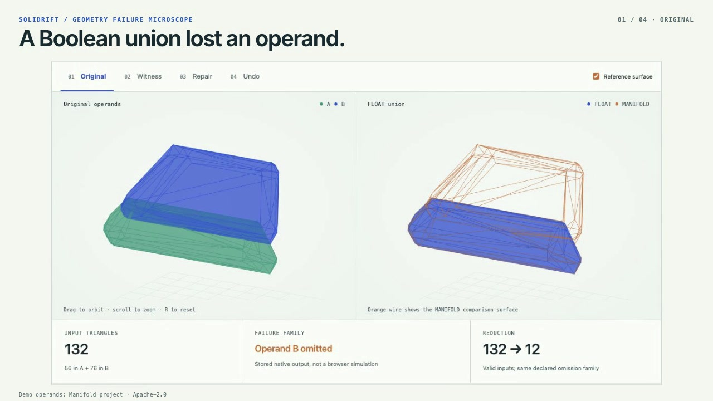

# Solidrift

**Shrink a geometry failure without losing the bug.**

A union should combine both solids. In the recorded Blender case, the `FLOAT` solver returns one and drops the other. Solidrift reduces 132 input triangles to a valid 12-triangle **witness**: a smaller input that keeps the same failure.

[Explore the native case](https://nazeeh111.github.io/Solidrift/) · [Methods and evidence](docs/EVIDENCE.md) · [Download](https://github.com/nazeeh111/Solidrift/releases)

[](https://nazeeh111.github.io/Solidrift/tour.html)

[Watch the 19-second tour](https://nazeeh111.github.io/Solidrift/tour.html) of the recorded Original → Reduction → Witness → Repair → Undo investigation. The reduction sequence samples stored input states, and only stored native output surfaces are shown. The included Manifold demo operands are Apache-2.0; attribution stays on screen. [Editable tour source](tools/tour/README.md).

Solidrift contracts edges while checking that both input solids (the operands) remain valid and closed, and the same native failure survives. It keeps each vertex's source history, searches small boundary interventions on the reduced witness, lifts them back to the full inputs, and tests the repair and undo in Blender. The result is a portable investigation, with meshes, coordinates and a 3D report a maintainer can inspect offline.

## Try the case

Python 3.10 or later. Blender with the `FLOAT` and `MANIFOLD` Boolean solvers. No Python dependencies, cloud service, account or model API.

```sh
git clone https://github.com/nazeeh111/Solidrift.git
cd Solidrift
python -m solidrift demo --blender /path/to/blender --out case
```

This runs the native engine from the original operands. The public viewer shows recorded outputs; it does not execute Blender in your browser.

## Investigate your own operands

```sh
python -m solidrift analyze A.obj B.obj --blender /path/to/blender --out my-case
```

Use a new output directory. Your original files are preserved. Accepted input is two triangular OBJ meshes, each one connected, closed and outward-oriented, with at most 256 triangles per operand. Coordinates are imported as Blender's binary32 values; the report records that conversion.

The current detector is deliberately specific: a `FLOAT` union that returns approximately operand A's signed volume while omitting the larger operand B. It does not detect every kind of Boolean error. Healthy inputs or unsupported failures produce an explicit result rather than a fabricated witness.

## What travels with the bug

- Original bytes and input identities.
- Original, reduced, repaired and restored mesh operands, plus native outputs.
- The accepted contraction trace, source clusters and before/after coordinate patch.
- Validity checks, comparison results, budgets and backend identity.
- An offline HTML viewer and machine-readable JSON report.

The viewer has linked orbit controls, intermediate input-state replay and clickable witness vertices for ancestry. Intermediate native output surfaces are not stored; the viewer says so instead of interpolating invented results.

## A real case, with conventional controls

On the included Manifold regression operands, Blender `5.3.0 Alpha`, build `bad8871dc58d`:

| Observation | Result |
|---|---|
| Original operands | 70 vertices / 132 triangles; both pass the single-shell guard |
| Failure-preserving reduction | 10 vertices / 12 triangles through 60 accepted contractions |
| Ordinary Decimate controls | 11 valid pairs, including equally small and smaller pairs; none retained this failure in the fixed sweep |
| Lifted intervention | Three witness vertices map to 13 original vertices; operand B and all faces stay unchanged |
| Full repaired exports | Matching oriented triangles; paired surface separation bounded by `4.28e-6` model units |
| Undo | Exact original input coordinates restored; native failed surface geometry reproduced |

Switching to MANIFOLD also works on the unchanged full case. Use it if you only need that workaround. Solidrift adds the small witness, the ancestry and the tested reversible intervention. These controls cover one case and one backend build, not all simplifiers or a universal repair algorithm.

## Limits you can inspect

The reducer is a bounded greedy search, not a globally smallest reproducer. The solid guard uses rational arithmetic on stored coordinates and conservative topology rules; it is not formally verified. Repair acceptance requires valid output surfaces, volume agreement and an oriented triangle correspondence within a declared tolerance. Equivalent surfaces with different triangulations may be refused. Agreement with MANIFOLD does not prove either output is the ideal mathematical union.

A repair changes input geometry. It does not repair Blender's implementation. The patch records the actual rounded before/after coordinates, and undo uses those stored values. Budgets are checked between native queries; a single query can exceed the search-time budget. The launcher also has a whole-process timeout.

See [the evidence](docs/EVIDENCE.md), [architecture](docs/ARCHITECTURE.md) and [contribution guide](CONTRIBUTING.md).

## License and provenance

Solidrift's implementation is MIT licensed. The included `Offset3.obj` and `Offset4.obj` fixtures are independently authored data from the [Manifold project](https://github.com/elalish/manifold), retained under Apache-2.0 with their source revision and license. See [NOTICE](NOTICE). They are regression data, not our original models.
